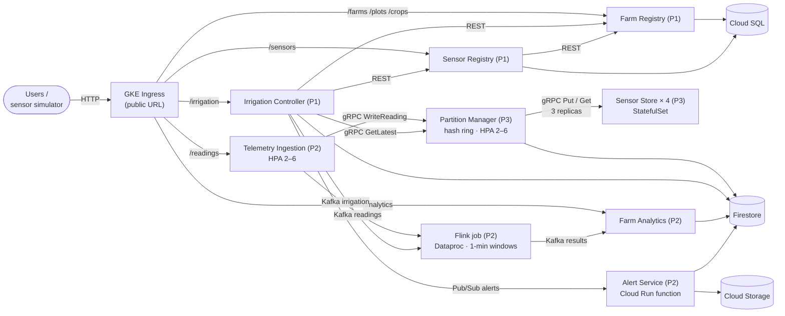

# S1 Smart Agriculture: Design Document

**CS/SS G527 Cloud Computing, group assignment, I Semester 2025-26** · Scenario S1: sensor-based irrigation across multiple farms · Required concept: **data partitioning using consistent hashing**

**Repository:** https://github.com/MrudulDhaduk/s1-smart-agriculture

| Person | ID No. | Name | Tasks | Services |
|---|---|---|---|---|
| 1 | 2026H1030068P | Saravanasudharsan S | (a) Terraform · (d) ArgoCD GitOps · (g) three storage products | Farm Registry · Sensor Registry · Irrigation Controller |
| 2 | 2026H1030074P | Pranav Harresh Vishwanathan | (b) serverless + REST/gRPC/queues · (e) Kafka + Flink | Telemetry Ingestion · Alert Service · Farm Analytics (+ Flink job) |
| 3 | 2026H1030069P | Mrudul | (f) consistent hashing · (c) GKE + HPA + k6 · (h) observability | Partition Manager · Sensor Store |

This document has a shared part (sections 1 to 7: system overview, architecture, responsibilities, interconnection, rationale, requirements) followed by one part per person with the details and evidence of their tasks:
**Part A** Infrastructure, GitOps and Storage (Person 1) · **Part B** Events and Streaming (Person 2) · **Part C** Concept, Scaling and Monitoring (Person 3).

---

## 1. System overview

Each farm is divided into **plots**, each growing one crop, and each plot has several soil-moisture **sensors**. The system:

1. **ingests** sensor readings over a public REST API;
2. **stores** every reading on 3 of 4 storage nodes chosen by a **consistent-hashing ring**, so a node can fail or join without losing or reshuffling most of the data;
3. **decides irrigation** every 30 s per plot: if the fresh soil moisture is below the crop's minimum, it computes the water needed, records the decision and raises an alert;
4. **aggregates** readings and watering decisions per farm in one-minute event-time windows on **Flink**, and serves the results over REST;
5. **handles alerts** asynchronously in a **serverless function** that stores and archives them.

It is 9 deployable components (8 microservices plus the Flink job) on Google Cloud, with Kafka on Aiven. Everything in the cloud is created by Terraform; everything in Kubernetes is deployed by ArgoCD from this repository. One public URL (a GKE Ingress) exposes all REST APIs.

**Verified on GKE** (13 and 16 Nov 2026): all ArgoCD Applications Synced/Healthy, 14 pods with 0 restarts; registries seeded through the public URL (5 farms, 20 plots, 200 sensors) and served from Cloud SQL; dry plots watered with events on Kafka and `DRY_SOIL` alerts on Pub/Sub; k6 load test 42,401 writes with 0 failures and both HPAs scaling (2 → 6 → 2 and 2 → 4 → 2); Flink on Dataproc producing per-farm windows that Farm Analytics serves (19 windows, 2,557 readings for `farm1`); Cloud Logging holding the logs of the pods and of the Flink job itself; the Alert Service turning a Pub/Sub alert into a Firestore document and a Cloud Storage archive object.

## 2. Microservice architecture

All seven GKE services run in namespace `s1` and are deployed by ArgoCD; Kafka is Aiven (topics `readings`, `irrigation`, `results`). Each arrow label names the mechanism (section 4); arrows into the three databases are the storage each service owns (Part A §4).

---

## 3. Microservice responsibilities

| Component | Owner | Runs as | Responsibility | State |
|---|---|---|---|---|
| **Telemetry Ingestion** | P2 | GKE Deployment, HPA 2–6 | Public `POST /readings`: validates readings, writes each through Partition Manager, publishes it to Kafka `readings` | Stateless |
| **Partition Manager** | P3 | GKE Deployment, HPA 2–6 | Owns the consistent-hashing ring: routes each write to 3 replica nodes and each read to a live replica; adds/removes nodes and rebalances | Ring membership in Firestore |
| **Sensor Store** | P3 | GKE StatefulSet, 4 nodes | One storage node of the ring; keeps its sensors' readings | SQLite on a persistent disk per node |
| **Farm Registry** | P1 | GKE Deployment, 2 pods | Farms, plots and crop thresholds (minimum/target moisture, root depth): REST CRUD | Cloud SQL `farm_registry` |
| **Sensor Registry** | P1 | GKE Deployment, 2 pods | Sensors and their plot; checks the plot exists in Farm Registry | Cloud SQL `sensor_registry` |
| **Irrigation Controller** | P1 | GKE Deployment, 1 pod | Every 30 s: latest readings per plot → water or not, litres = area × moisture deficit × root depth; 10-min cooldown; emits decision events and alerts | Cooldown in Firestore (transactional) |
| **Flink job** | P2 | Dataproc (Flink 1.17 on YARN) | Joins `readings` and `irrigation` per farm in 1-min tumbling event-time windows; writes summaries to `results` | Flink keyed state |
| **Farm Analytics** | P2 | GKE Deployment | Consumes `results`, stores per-farm summaries and totals idempotently, serves `GET /analytics/farms/{id}` | Firestore `farm_summaries` |
| **Alert Service** | P2 | Cloud Run function (2nd gen), Pub/Sub trigger | Validates each alert, stores it in Firestore under a deterministic id and archives the raw JSON in Cloud Storage | Firestore `alerts`, GCS archive |

Supporting platform (not microservices): ArgoCD, External Secrets Operator, Prometheus + Grafana (kube-prometheus-stack), Cloud Logging.

---

## 4. Interconnection mechanisms

All three styles required by task (b) are used, each where its properties fit:

| From → To | Mechanism | Why this mechanism |
|---|---|---|
| Users, simulator → all public APIs | **REST** over one HTTP load balancer (GKE Ingress) | Universal client support; one public URL |
| Irrigation Controller → Farm / Sensor Registry; Sensor Registry → Farm Registry | **REST** inside the cluster | Simple CRUD lookups, low volume |
| Telemetry Ingestion, Irrigation Controller → Partition Manager → Sensor Store | **gRPC** (`contracts/*.proto`) | Typed contract, binary and fast on the hot path of every reading |
| Telemetry Ingestion → Flink (`readings`); Irrigation Controller → Flink (`irrigation`); Flink → Farm Analytics (`results`) | **Kafka** (Aiven, mutual TLS) | Durable, replayable, ordered per key: a stream processor needs exactly this |
| Irrigation Controller → Alert Service | **Pub/Sub** topic `alerts` → Eventarc | Native trigger for the serverless function; retries with at-least-once delivery, made idempotent by `alert_id` |

Message formats are fixed in `contracts/` (protos, Kafka and Pub/Sub JSON examples, REST specs) and were agreed by all three members before building against each other.

---

## 5. Cloud deployment architecture

One GCP project in `us-central1` (zone `us-central1-a`) plus a free Aiven Kafka service. The infrastructure is split into Terraform stacks by lifetime: `bootstrap` (APIs, state bucket) and `foundation` (VPC, Artifact Registry, Cloud SQL, Firestore, buckets, Pub/Sub, service accounts, IAM) stay up; `kafka` (Aiven) and `serverless` (Alert Service) stay up at no idle cost; `cluster` (GKE + Dataproc) and `platform` (ArgoCD) exist only during work sessions and are destroyed afterwards. The full deployment diagram and the reasons for each product are in **Part A, section 1**.

| Layer | Product |
|---|---|
| Compute | GKE zonal Standard cluster (2–4 × e2-standard-2, autoscaled), Dataproc single node, Cloud Run function |
| Messaging | Aiven Kafka (topics `readings`, `irrigation`, `results`), Pub/Sub (`alerts`) |
| Storage | Cloud SQL Postgres (registries), Firestore (ring, cooldown, summaries, alerts), Cloud Storage (alert archive, Flink jar, Dataproc staging) |
| Delivery | Artifact Registry, ArgoCD tracking `main`, External Secrets from Secret Manager |
| Identity | One service account per workload, Workload Identity for pods, IAM database login; no keys anywhere |
| Observability | Prometheus + Grafana in the cluster, Cloud Logging for pods, Dataproc and the function |

---

## 6. Rationale for the main cloud design choices

| Choice | Reason | Details |
|---|---|---|
| Consistent hashing with virtual nodes and 3 replicas | Adding a node moves 18% of the keys instead of 80% with `hash % N`; any 2 node failures lose nothing | Part C §2 |
| HPA only on the stateless services | A new Sensor Store pod would not be on the ring; the data tier scales by adding a ring node | Part C §4.2 |
| Three storage products by data shape | Relational registries with foreign keys → Cloud SQL; small documents and transactions → Firestore; immutable objects → Cloud Storage | Part A §4 |
| Kafka for streams, Pub/Sub for alerts | Flink needs a replayable log; the function needs a native push trigger | §4 above, Part B §2 |
| Event-time windows in Flink | Results depend on when readings happened, not when they arrived | Part B §2.2 |
| Terraform stacks by lifetime | The costly cluster is destroyed daily without touching data | Part A §2 |
| ArgoCD with a GKE overlay, commit-tagged images | Git is the only way to deploy; every running image names its commit | Part A §3 |
| Secrets via Secret Manager + External Secrets, Workload Identity | No secret in Git and no service-account key files | Part A §7 |
| Zonal cluster, single-node Dataproc, free Kafka, no Cloud NAT | The whole project runs on a $50 credit | Part A §8 |

---

## 7. How each requirement is met

| Req. | Requirement | Where | Evidence |
|---|---|---|---|
| (a) | All infrastructure as code | `infra/` (6 Terraform stacks) | Every resource in Terraform state; drift check clean; cluster rebuilt from code for every session (Part A §2) |
| (b) | Serverless async function; REST, gRPC and queues | `services/alert-function`, `infra/serverless`, `contracts/` | Alert Service deployed by Terraform; a `DRY_SOIL` alert published to Pub/Sub was stored in Firestore `alerts` and archived in Cloud Storage; the first deliveries were refused while IAM propagated and Pub/Sub's retries then succeeded. REST, gRPC, Kafka and Pub/Sub all carry live traffic (§4, Part B §2.3) |
| (c) | GKE, HPAs on two services, k6 load test | `k8s/`, `loadtest/` | 42,401 writes, 0 failed; Partition Manager 2 → 6 → 2, Telemetry Ingestion 2 → 4 → 2 (Part C §4.4) |
| (d) | GitOps, no `kubectl apply` | `infra/platform`, `k8s/gke` | 4 ArgoCD Applications tracking `main`, auto-sync with prune and self-heal (Part A §3) |
| (e) | Flink on a managed cluster, stateful windows, `results` topic | `services/flink-job` | Job on Dataproc; per-farm 1-min windows served by Farm Analytics (Part B §5) |
| (f) | Consistent hashing | `services/partition-manager`, `services/sensor-store` | 18.4% keys moved on join vs 80.2%; 100% readable after a node crash; live on GKE (Part C §2) |
| (g) | Three storage products | `infra/foundation` | Cloud SQL, Firestore, Cloud Storage, each used by running services (Part A §4) |
| (h) | Prometheus, Grafana, centralised logging incl. the analytics job | `observability/` | Grafana dashboard on GKE; Cloud Logging for all pods and for the Flink job (`resource.type="cloud_dataproc_job"`, 815 entries from the running job) (Part C §5) |

**Run it:** local development with `docker compose up` (see the top-level `README.md`); the cloud with `infra/README.md` (`infra/scripts/up.sh`, then `down.sh`).
