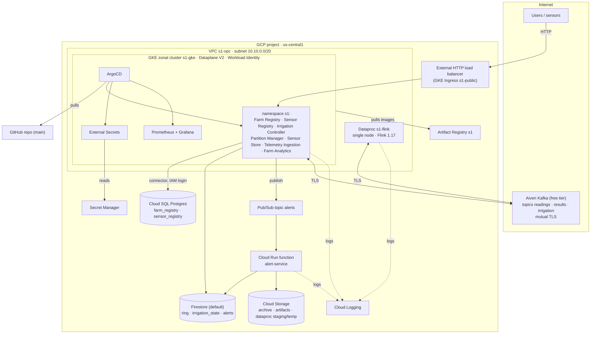
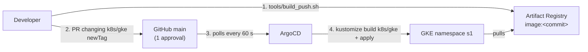

# Person 1: Infrastructure, GitOps and Storage

**Owner:** Saravanasudharsan S · **Tasks:** (a) all infrastructure as code with Terraform · (d) GitOps with ArgoCD · (g) three cloud storage products
**Services:** Farm Registry, Sensor Registry, Irrigation Controller

> **In one line:** every cloud resource is created by Terraform, every Kubernetes object by ArgoCD from Git, and each kind of data lives in the storage product that fits it.

---

## 1. Cloud deployment architecture

One GCP project (`us-central1`, zone `us-central1-a`) plus a free Aiven Kafka service. Everything below is created by Terraform.

| Need | GCP implementation | Why this one |
|---|---|---|
| Kubernetes | GKE **zonal Standard** cluster, 2–4 × e2-standard-2 nodes (autoscaled), `pd-standard` disks | The free tier covers the management fee of one zonal cluster; Standard lets us size nodes ourselves |
| Network | Own VPC + subnet with pod/service ranges, public node IPs, no Cloud NAT | Network defined in code; public IPs give internet access (Aiven, images) without NAT's hourly charge |
| NetworkPolicy | Dataplane V2 (`ADVANCED_DATAPATH`) | Enforces Person 3's "only Partition Manager may reach Sensor Store" policy; without it GKE ignores NetworkPolicies |
| Flink | Dataproc single node, image 2.2 (Flink 1.17), Component Gateway, idle auto-delete after 2 h | Managed Flink on YARN, smallest possible cluster; deletes itself if forgotten |
| Kafka | Aiven free tier (`free-0`), created by Terraform | Managed, no cost; reached over TLS from GKE and Dataproc |
| Serverless | Cloud Run function (2nd gen) triggered by Pub/Sub via Eventarc | Scales to zero; runs only per alert |
| Images | Artifact Registry `s1` with a cleanup policy | Private registry next to the cluster; keeps the newest 5 versions |
| Secrets | Secret Manager → External Secrets Operator → Kubernetes Secrets | No secret in Git, no key files; rotation = new Secret Manager version |

## 2. Task (a): infrastructure as code

### 2.1 Stacks

The Terraform code (`infra/`) is split by **lifetime**, each stack with its own state, so the expensive part can be destroyed every evening without touching the data:

| Stack | Creates | Lifetime |
|---|---|---|
| `bootstrap` | project APIs, the state bucket, budget alerts | once per project |
| `foundation` | VPC, firewall, Artifact Registry, Firestore, Cloud SQL (+ databases, IAM users), buckets, Pub/Sub, one service account per workload, IAM, runtime config in Secret Manager | whole project |
| `kafka` | Aiven Kafka, topics, app user + ACL, connection details in Secret Manager | whole project |
| `serverless` | the Alert function, its trigger and invoker permission | whole project |
| `cluster` | GKE + node pool, Dataproc + its buckets, Workload Identity bindings | **only while working** |
| `platform` | ArgoCD and its Applications (Helm) | with the cluster |

Stacks read each other's outputs with `terraform_remote_state` (e.g. `cluster` takes the subnet and service accounts from `foundation`).
`infra/scripts/up.sh` / `down.sh` start and stop a work session; `down.sh` first deletes the app namespaces so GKE also removes the load balancer and disks it created.

### 2.2 State

Remote state in a private, versioned GCS bucket (`<project>-tfstate`, prefix per stack). The bucket name is passed at `terraform init`, so the same code works in another project (our fallback is Person 3's project). The bootstrap stack creates that bucket with local state first, then migrates its own state into it.

### 2.3 What is not in Terraform, and why

- **The project and its billing link**: Terraform needs an existing project to run against.
- **Kubernetes workloads**: those are GitOps (task d). Terraform installs ArgoCD itself and nothing else inside the cluster.
- **Account sign-ups** (Aiven, GitHub): they come before any API exists.

### 2.4 Pitfalls the code handles (each found in the provider/product docs)

- Postgres 16 defaults to the ENTERPRISE_PLUS edition, which has no small machine types → `edition = "ENTERPRISE"`.
- Dataproc 2.2+ creates internal-IP-only VMs by default → `internal_ip_only = false`, or Flink could not reach Kafka without NAT.
- Flink logs only reach Cloud Logging with `dataproc.logging.stackdriver.job.driver.enable` and `.job.yarn.container.enable`.
- Cloud SQL instance names are reserved for days after deletion → random suffix.
- The Workload Identity pool exists only once a cluster does → the KSA→GSA bindings live in the `cluster` stack.
- ArgoCD `Application` objects cannot be planned before ArgoCD's CRDs exist → created through the `argocd-apps` Helm chart.

## 3. Task (d): GitOps with ArgoCD

- **Four Applications** (defined in `infra/platform/argocd.tf`): `s1` (path `k8s/gke`), `external-secrets` (Helm chart), `monitoring` (kube-prometheus-stack with Person 3's values file from Git), `observability` (ServiceMonitors and the dashboard from Git).
- **Sync policy:** automated, `prune` (deleted from Git → deleted from the cluster) and `selfHeal` (manual changes are reverted). Nobody runs `kubectl apply`; a deployment is a merged pull request.
- **HPA vs. self-heal:** the `s1` Application ignores `/spec/replicas` of Deployments. Otherwise ArgoCD would reset every HPA scale-out back to the replica count in Git.
- **Overlays:** `k8s/base` is environment-neutral; `k8s/local` (Person 3) runs it on a laptop; `k8s/gke` adds what only exists on our project: Artifact Registry images with commit tags, Workload Identity annotations, the Secret wiring and the public Ingress.
- **Images are tagged with the git commit**, never `latest`: a new image only reaches the cluster through a Git change, so Git always says exactly what is running and a rollback is a `git revert`.
- **Secrets:** Terraform writes them to Secret Manager; the `ExternalSecret` objects in Git say *which* secret goes *where*, never the value.

## 4. Task (g): three storage products

| Product | Holds | Why it fits |
|---|---|---|
| **Cloud SQL (PostgreSQL)**, managed SQL | Farm Registry (`farms`, `plots`, `crops`) and Sensor Registry (`sensors`), one database each | Relational data with foreign keys (a plot must belong to a farm and grow a known crop), ad-hoc queries, transactions |
| **Firestore (Native)**, managed NoSQL | Hash-ring membership (Person 3), watering cooldown per plot (`irrigation_state`), alert documents (Alert function), analytics summaries (Farm Analytics) | Small documents read/written by many stateless pods; transactions for the cooldown; no schema or server to manage |
| **Cloud Storage**, object store | Alert payload archive (30-day lifecycle), Flink job jar and function source (`artifacts`), Dataproc staging/temp | Cheap durable blobs; the services that run code (Dataproc, Cloud Run) read their artifacts from here |

Sensor readings themselves are on the Sensor Store nodes (Person 3's consistent-hashing ring), not in any of these.

**No passwords:** the registries log into Cloud SQL as their own Google service account (IAM database authentication through the Cloud SQL connector, authorised by Workload Identity). The instance has a public IP but no authorised networks, so only IAM-authorised connector clients can reach it.

## 5. My services

| Service | Responsibility | Interfaces |
|---|---|---|
| **Farm Registry** | Farms, plots and crops (a crop defines the moisture band and root depth) | REST (public via Ingress); Cloud SQL |
| **Sensor Registry** | Sensors, their plot/farm and status (`active`, `inactive`, `faulty`) | REST (public); REST → Farm Registry to validate the plot; Cloud SQL |
| **Irrigation Controller** | Every 30 s: average each plot's fresh readings, water plots below their crop's minimum, alert on dry soil and silent sensors | REST → both registries; **gRPC** `GetLatest` → Partition Manager; **Kafka** `irrigation` (watering events); **Pub/Sub** `alerts`; Firestore cooldown |

Water per decision: `area_m2 × (target − moisture) × root_depth_cm / 10` litres (1 % of 1 m² × 1 cm of soil = 0.1 L). A plot is watered at most once per 10 minutes; the claim is a Firestore transaction, so a restart or a second replica cannot water twice.

All three are stateless Deployments with readiness/liveness probes, JSON logs (one object per line with `service`, `level`, `message`, `plot_id` where relevant) and Prometheus metrics on `:8000/metrics` (`http_requests_total`, `http_request_duration_seconds`, `irrigation_*`).

**Verified locally** (Docker Compose, no cloud): seed 5 farms / 20 plots / 200 sensors → `pmctl write 2000` through the hash ring → the controller reads them back over gRPC, waters the 4 rice plots once (cooldown on the second cycle) and the decisions arrive on Kafka `irrigation` keyed by plot.

## 6. Communication mechanisms (task b, my part)

| Mechanism | Where |
|---|---|
| REST | users → registries / Irrigation Controller (Ingress); Sensor Registry → Farm Registry; Irrigation Controller → both registries |
| gRPC | Irrigation Controller → Partition Manager `GetLatest` |
| Message queues | Irrigation Controller → Kafka `irrigation`; Irrigation Controller (and Partition Manager) → Pub/Sub `alerts` → Alert function |

## 7. Security

- One Google service account per workload with only its own roles; pods get them through **Workload Identity** (no JSON keys exist).
- Secrets only in Secret Manager → External Secrets → Kubernetes Secrets; `*.tfvars`, state and plans are git-ignored; state bucket is private.
- The Alert function accepts internal traffic only (Eventarc); Grafana and Prometheus have no public IP (port-forward).
- Teammates get `viewer`, `container.developer` and `dataproc.editor`, not `editor` or `owner`.

## 8. Cost and trade-offs ($50 credit)

| Choice | Saves | Gives up |
|---|---|---|
| Zonal cluster | management fee (free tier) | control plane in one zone |
| Public nodes, no Cloud NAT | NAT hourly + data charges | nodes have public IPs (firewalled; GKE only opens what it needs) |
| Single-node Dataproc, idle auto-delete | 2 worker VMs; forgotten clusters | no Flink fault tolerance across machines |
| Aiven free tier | all Kafka cost | 250 KiB/s, 5 topics, powers off after 24 h idle (power on before the demo) |
| `db-f1-micro`, HDD, no backups | most of Cloud SQL's cost | demo data only |
| Destroy `cluster` + `platform` after each session | ~90 % of the hourly cost | ~15 min to start a session |
| Budget alerts on cost before credits | n/a | they warn, they do not stop spending |
