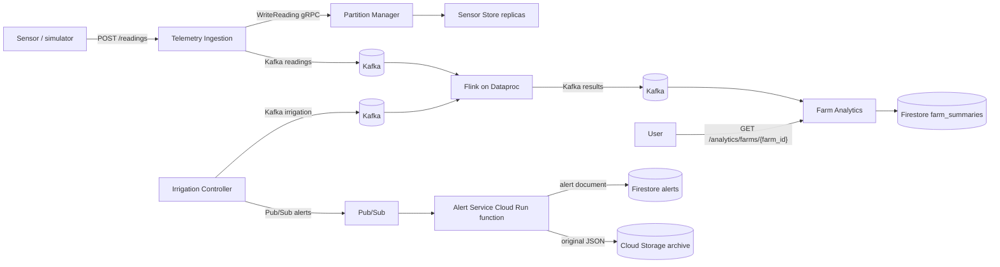

# Person 2: Events and Streaming

**Owner:** Pranav Harresh Vishwanathan (`2026H1030074P`) — Person 2 · **Tasks:** (b) Serverless function + REST/gRPC/queues · (e) Kafka + Flink stream processing
**Services:** Telemetry Ingestion · Alert Service · Flink job · Farm Analytics

> **In one line:** readings pass through the partitioned storage path and Kafka, Flink combines sensor and irrigation events into farm windows, Farm Analytics persists the results, and Pub/Sub alerts are persisted and archived separately.

## 1. Architecture and data flows



`POST /readings` accepts one reading or a non-empty `{"readings": [...]}` batch. Telemetry validates each item, writes it through Partition Manager's `WriteReading` gRPC call, and publishes it to Kafka topic `readings`, keyed by `sensor_id`. A successful `202` means the write and broker acknowledgement succeeded for every reading. The HTTP Ingress routes `/readings` and `/analytics` to their respective services.

Flink consumes both `readings` and `irrigation`. The Irrigation Controller publishes watering decision events to `irrigation` and alerts such as `DRY_SOIL` to Pub/Sub `alerts`; those are two separate paths. Flink groups both event types by farm and emits a result to Kafka topic `results`, keyed by `farm_id`. Farm Analytics consumes `results`, validates and stores each farm summary in Firestore, and serves the latest window plus cumulative totals at `GET /analytics/farms/{farm_id}`.

The Alert Service is a Pub/Sub triggered Cloud Run function. It validates the alert, creates a Firestore document keyed by `alert_id`, and stores the original Pub/Sub JSON in the archive bucket at `alerts/YYYY/MM/DD/<alert_id>.json`, using the UTC date derived from `detected_at_ms`. The archive write has a generation precondition, so a prior object is not overwritten.

## 2. Event and delivery behavior

### 2.1 Telemetry ingestion

- Reading input requires a non-empty `sensor_id` and positive integer `timestamp_ms`; the optional numeric fields default to zero. Unknown fields are rejected.
- Partition Manager writes are retried a bounded number of times (default 3) for transient gRPC codes, with exponential delay starting at 50 ms. Non-retryable status codes stop immediately. The same sensor/timestamp write is safe to repeat because the storage key is `(sensor_id, timestamp_ms)`.
- Kafka producer idempotence is enabled for producer-session retries, and the handler waits for delivery acknowledgement (default timeout 5 seconds) before returning success.
- Storage happens before publication. If Kafka fails after storage, the service returns `503` with `stored_not_published`; it does not roll back storage. A caller retry may publish a duplicate (including when an acknowledgement was lost), and retrying a partly failed batch can repeat previously successful entries. Producer idempotence does not deduplicate client retries or process restarts. Consumers should deduplicate readings by `(sensor_id, timestamp_ms)` where needed.

### 2.2 Flink windows

- Each stream extracts its event timestamp (`timestamp_ms` for readings, `decided_at_ms` for irrigation). Both use bounded-out-of-order watermarks of 10 seconds and mark idle source subtasks after 30 seconds so one quiet topic can stop holding back the union watermark.
- The operator uses UTC epoch-aligned, one-minute tumbling event-time windows `[window_start_ms, window_end_ms)`. An event exactly at the end boundary is in the next window. The output is emitted after the watermark passes the end; the out-of-order allowance means a later timestamp is needed to advance it. Allowed lateness is zero, so events arriving after window closure are dropped.
- Each non-empty farm/window produces one summary with reading count, distinct sensor count, moisture statistics, watering-event count, and water litres. An irrigation-only window has `readings: 0`, `sensors: 0`, zero watering-independent reading metrics, and JSON `null` for average/minimum/maximum moisture. Empty windows produce no result.
- Malformed or invalid records are dropped. Flink does **not** deduplicate source messages: duplicates count more than once. The Kafka sink uses its default `NONE` delivery guarantee and there is no configured checkpoint storage/recovery policy. A process restart can therefore lose buffered output or replay input and create duplicate results. Farm Analytics deduplicates a repeated farm/window result, but this does not prevent input duplicates that Flink already counted into a window.

### 2.3 Farm Analytics and alerts

- Farm Analytics applies each result and writes a processed-window marker and updated farm totals in one Firestore transaction. A repeated `(farm_id, window_start_ms, window_end_ms)` is ignored; an older unique window adds to totals without replacing the latest-window fields.
- The Kafka consumer commits an offset only after persistence. Persistence failures retry the same message; a failed synchronous commit stops consumption so group reassignment can replay it. Invalid result messages are logged and committed to avoid blocking their partition.
- Pub/Sub-triggered Alert Service retries are enabled in Terraform. Firestore `create()` and the GCS `if_generation_match=0` upload make redelivery idempotent without overwriting an existing alert or archive object. Invalid alerts are logged and acknowledged; Firestore/GCS client failures are raised so the event can be retried. If Firestore succeeds but GCS fails, a retry leaves the existing Firestore document intact and attempts the archive again.

## 3. Local development and tests

### Telemetry Ingestion + Farm Analytics

From the repository root, run `docker compose up --build -d`. Telemetry is at `http://localhost:8084`; Farm Analytics is at `http://localhost:8085`. Compose uses local Kafka (`kafka:9092`), plaintext, and an in-memory analytics repository. For end-to-end local Kafka processing, publish a `results` message as shown in [Farm Analytics README](../services/farm-analytics/README.md). For the Flink job itself, start the compose Kafka broker and use the laptop-facing address `localhost:29092`.

```sh
cd services/telemetry-ingestion && PYTHONPATH=../web-common python -m pytest -q
cd ../farm-analytics && PYTHONPATH=../web-common python -m pytest -q
```

### Flink

Requires JDK 11 and Maven 3.8+. From `services/flink-job`:

```sh
mvn test
mvn package
```

The tests include a local Flink mini-cluster pipeline for event-time windows, late/out-of-order events, boundaries, distinct sensors, irrigation and water totals. The README's `scripts/local-kafka-smoke.sh` exercises the running compose Kafka topics, including late-event discard and an idle irrigation stream; it requires Docker running.

### Alert Service

Requires Python 3.12. From `services/alert-function`:

```sh
python3.12 -m pip install -r requirements.txt pytest
python3.12 -m pytest -q
```

Tests mock Firestore and GCS and need no cloud credentials. For local handler development, set `GOOGLE_CLOUD_PROJECT=local` and `ARCHIVE_BUCKET=local-alert-archive`, then run `python3.12 -m functions_framework --target handle_alert --signature-type cloudevent`.

## 4. Deployment

The platform is provisioned by Terraform and GKE workloads are applied through ArgoCD from `main`; deployment instructions for the overall platform are in [infra/README.md](../infra/README.md). Person 2's specific cloud components are:

- Alert Service: Terraform stack `infra/serverless/`, function name `alert-service`, Python 3.12, Pub/Sub trigger on `alerts`; its service account can write Firestore alerts and create objects in the archive bucket.
- Telemetry Ingestion and Farm Analytics: their GKE manifests are in `k8s/base`, with GKE configuration and Ingress routes in `k8s/gke`. Production Farm Analytics selects Firestore via `ANALYTICS_STORE=firestore`; the Kafka client uses the `kafka-client` Kubernetes Secret.
- Flink: package the job with Maven, upload the JAR, then submit it through the Dataproc Jobs API. The Cloud project is `s1-agri-ams-686974`, region `us-central1`, Dataproc cluster `s1-flink`, and deployed artifact `gs://s1-agri-ams-686974-s1-artifacts/flink/flink-job-1.0.0.jar`. Kafka client properties are read from Secret Manager by the Dataproc service account; do not put credential payloads in command arguments or Git.

The successful submission used these Flink properties:

```text
parallelism.default=1
jobmanager.memory.process.size=1600m
taskmanager.memory.process.size=1728m
taskmanager.numberOfTaskSlots=1
```

Parallelism `1` resolves the invalid-parallelism submission failure. One TaskManager slot, with the stated JobManager and TaskManager process memory allocations, resolves YARN's task-slot allocation failure on this single-node cluster. These values are the observed working configuration for this deployment; they are not a general production sizing recommendation.

The relevant submission shape (with the project Secret Manager resource name as the application argument) is:

```sh
gcloud dataproc jobs submit flink --cluster=s1-flink --region=us-central1 \
  --jar=gs://s1-agri-ams-686974-s1-artifacts/flink/flink-job-1.0.0.jar \
  --properties=flink:parallelism.default=1,flink:jobmanager.memory.process.size=1600m,flink:taskmanager.memory.process.size=1728m,flink:taskmanager.numberOfTaskSlots=1 \
  -- --KAFKA_CLIENT_PROPERTIES_SECRET projects/s1-agri-ams-686974/secrets/kafka-client-properties/versions/latest
```

## 5. Deployment and end-to-end verification record

The following is the deployment and integration result reported by the team on **November 16, 2026**. It is included as a team-reported cloud verification record; this documentation change did not independently query the live GCP job or services.

- Dataproc Flink job ID: `ae6e697018a34ceab2e89ed0042728a0`, reported successfully running on November 16, 2026.
- The team sent readings to farms `farm1` through `farm5` using `tools/simulate_sensors.py` and exercised the deployed GKE path.
- `GET http://34.8.83.183/analytics/farms/farm1` returned a latest one-minute window with **192 readings from 40 sensors** and **33.3% average moisture**. The update appeared about **12 seconds after window end**.
- The reported cumulative totals were **18 windows** and **2,357 readings**.

This verifies the reported Telemetry Ingestion → Kafka `readings` → Flink → Kafka `results` → Farm Analytics → Firestore/API path for that run. It does not establish sustained throughput, recovery after a Flink restart, exactly-once delivery, or behavior for late events beyond the local tests. The available team notes do not independently confirm the Alert Service's live Pub/Sub-to-Firestore/GCS path for the same session, nor Flink's own application logs in Cloud Logging; cluster service logs were observed by Person 3, but those are distinct from the Flink job's own log lines.

## 6. Known limitations

| Limitation | Effect |
|---|---|
| Flink has no checkpoint storage, stable savepoint, or restart policy configured | Restart can replay retained input and duplicate windows, or lose buffered sink output. |
| Kafka results sink has delivery guarantee `NONE` | A broker/process failure can lose in-flight output. |
| Flink does not deduplicate readings or irrigation events | Repeated input records inflate counts/totals. |
| Zero allowed lateness | Late records after the window watermark closes it are discarded, with no correction stream. |
| Exact distinct sensor set held for each open window | State grows with active farms, sensors, and window concurrency. |
| Alert archive stores raw event JSON | Access and retention policy for archived alerts must be managed at the bucket level. |

## 7. Status and ownership follow-up

| Deliverable | Status |
|---|---|
| Telemetry Ingestion, Alert Service, Flink, Farm Analytics source and local tests | Implemented; test commands are documented above. |
| Cloud deployment and GKE end-to-end analytics | Team-reported successful verification on November 16, 2026, with the measured values above. |
| Person 2 identity in `task_divison.txt` | Confirmed: Pranav Harresh Vishwanathan (`2026H1030074P`). Ensure the roster uses this exact ID instead of the previously entered `H20260074P`. |
| Live Alert Service / Pub/Sub / Firestore / GCS verification | Not established by the available verification notes. |
| Flink job's own Cloud Logging output | Not established by the available verification notes. |
