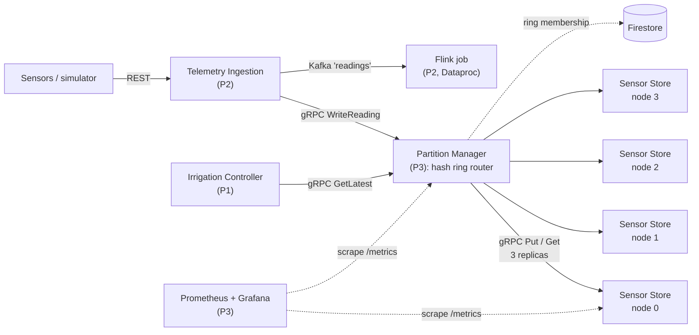
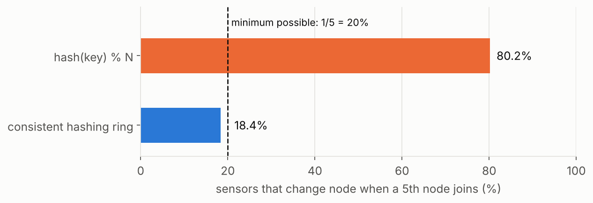
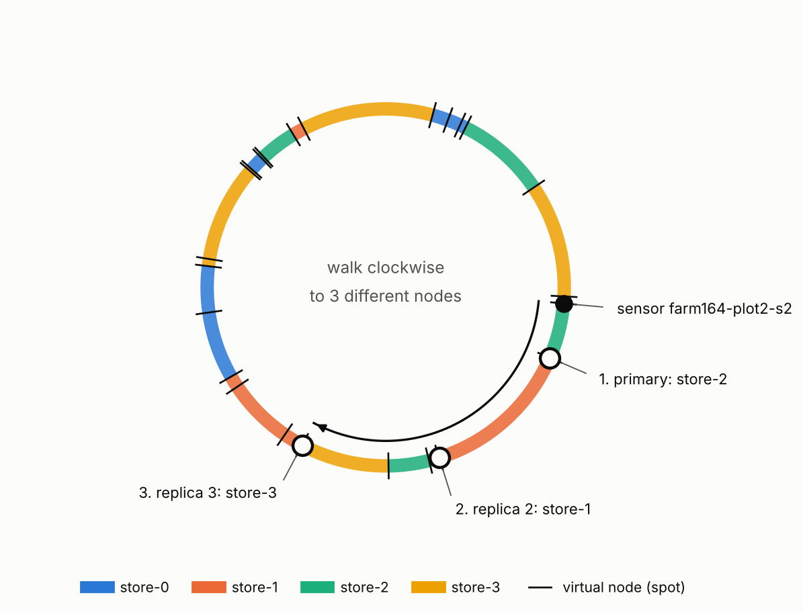
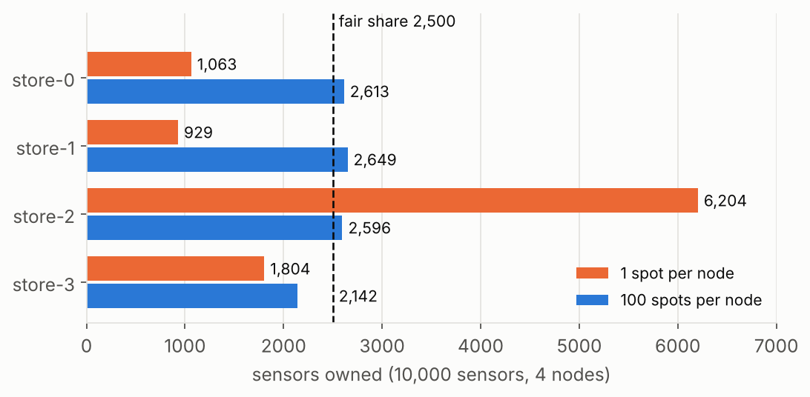
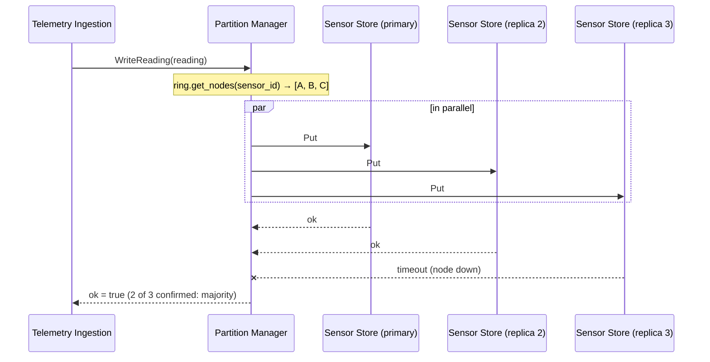
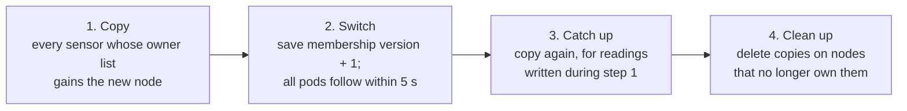
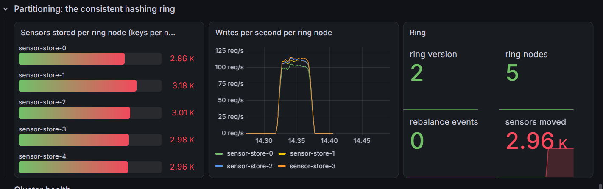
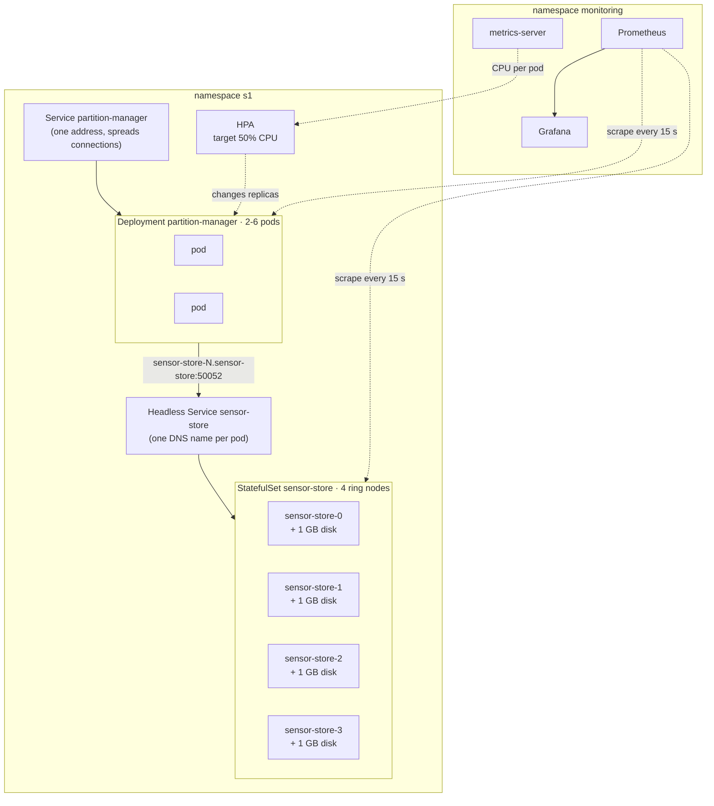
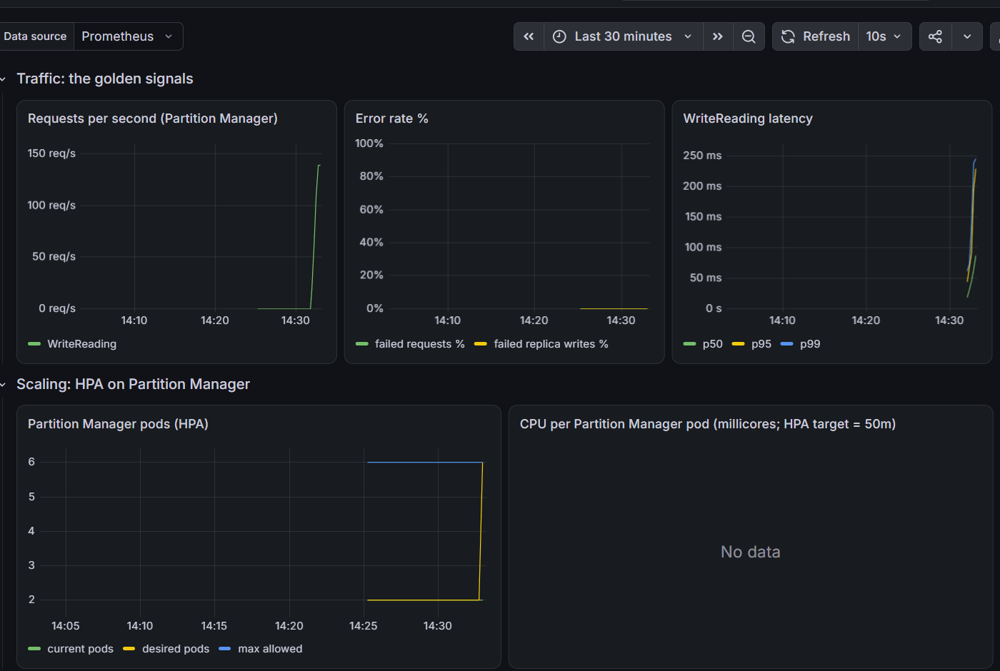
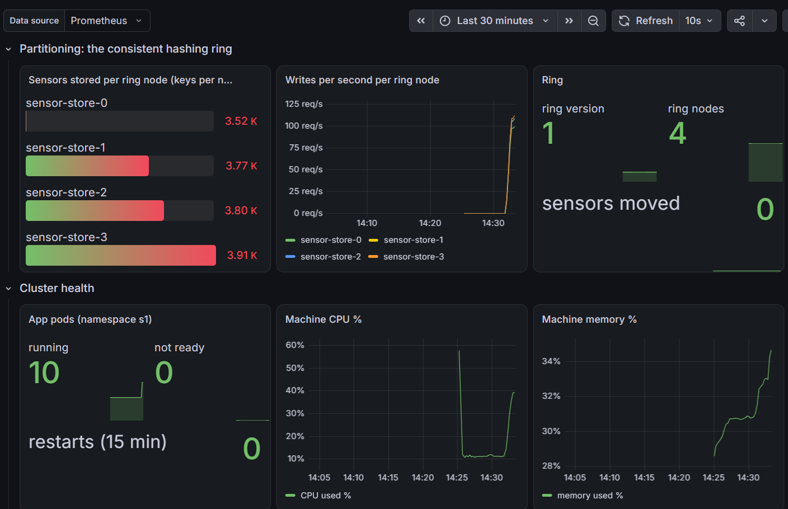

# Person 3: Concept, Scaling and Monitoring

**Owner:** Mrudul · **Tasks:** (f) data partitioning with consistent hashing · (c) Kubernetes, Horizontal Pod Autoscalers and load testing · (h) monitoring, dashboards and centralised logging
**Services:** Partition Manager, Sensor Store

> **In one line:** I built the logic that spreads sensor data across storage nodes, and proved on live dashboards that the system scales.

---

## 1. Where my part sits in the system

Every soil-moisture reading enters through Telemetry Ingestion (Person 2) and is stored through my two services. Irrigation Controller (Person 1) reads the latest readings back through the same router.

| Service | Responsibility | Kind of workload |
|---|---|---|
| **Partition Manager** | Runs the consistent hashing ring. Routes every write to its 3 replica nodes and every read to a live replica. Adds and removes ring nodes and rebalances the data. | Stateless router: a Kubernetes **Deployment** scaled by an **HPA** |
| **Sensor Store** | One storage node of the ring. Keeps the readings of the sensors assigned to it in SQLite on its own disk. | Stateful: a Kubernetes **StatefulSet**, one persistent disk per node |

---

## 2. Task (f): data partitioning with consistent hashing

### 2.1 The problem: `hash(key) % N` breaks when N changes

Thousands of sensors produce more readings than one machine should hold, so the data is split across N storage nodes. The obvious rule, used in the Scalability lecture (slide 30: *"user_id % 4 is used as the hash function"*), is `node = hash(sensor_id) % N`.

That rule ties every key's address to **N**. When a fifth node joins, the result of `% 5` differs from `% 4` for almost every key. Our demo with 10,000 sensors measured it:

- **`hash % N` moved 80.2%** of the sensors. In general it moves about `(N−1)/N` of all keys.
- **The minimum possible is 20%.** The new node must receive its fair share, 1/5 of the keys, and nothing else needs to move.
- **The consistent hashing ring moved 18.4%, and every moved key went to the new node.** Old nodes never swap keys with each other.

Moving a key is not free: its readings must be copied over the network while the system is live. The lecture states the problem directly (slide 31): *"requires updating the sharding function and moving data around the cluster… Consistent Hashing solves this problem."*

### 2.2 How the ring works

*Figure: the real `HashRing` code with 4 nodes and 6 spots each (the system uses 100). The sensor walks clockwise and collects 3 different nodes. Just after the primary it passes another store-2 spot, which is skipped because store-2 already holds a copy.*

1. **Positions.** MD5 turns any text into a number between 0 and 2¹²⁸, which is a position on a circle. MD5 is used instead of Python's `hash()` because `hash()` is randomised every time Python starts, and every Partition Manager replica must compute the **same** position for the same sensor. MD5 is used only to spread keys evenly, not for security.
2. **Ownership.** A sensor belongs to the **first node clockwise** from its position. Each node owns the arc of the ring that ends at it.
3. **A joining node** lands inside some arcs and takes over only those parts. Every other key's walk is unchanged, which is why only about 1/N of keys move.
4. **Virtual nodes (100 per node).** Each node is placed at 100 spots (`store-2#0` … `store-2#99`). With one spot per node, a node's share is **one random gap**, which can be tiny or huge. With 100 spots, its share is the **sum of many random gaps**, and the luck averages out:

With 1 spot, store-2 held **62%** of the data. With 100 spots every node is close to the fair 2,500. Virtual nodes also mean a joining node takes a small slice from **every** existing node instead of a large slice from one unlucky neighbour.

5. **Replication factor 3.** A sensor is stored on its primary **plus the next 2 different nodes clockwise**. Spots belonging to a node already chosen are skipped, because two copies on one machine would die together.
6. **Partition key = `sensor_id`.** Keying by `farm_id` would put all of a large farm's sensors on the same 3 nodes: the hot-key ("celebrity") problem from Scalability slide 31. Keying by `sensor_id` spreads one farm across the whole ring.

### 2.3 Evidence

| What `demo.py` measured (10,000 sensors) | Result |
|---|---|
| Keys moved when a 5th node joins | `% N`: **80.2%** · ring: **18.4%**, all to the new node |
| Spread over 4 nodes, 1 spot per node | 1,063 / 929 / **6,204** / 1,804 |
| Spread over 4 nodes, 100 spots per node | 2,613 / 2,649 / 2,596 / 2,142 (fair = 2,500) |
| Readable after one node crashes, 1 copy | 74.0% (the crashed node's 25.96% is lost) |
| Readable after one node crashes, 3 copies | **100%** |
| Readable after three of four nodes crash, 3 copies | 71.8%: replication factor 3 survives **any 2** failures, not 3 |

**Tests:** 8 unit tests for the ring (`test_ring.py`) and 5 end-to-end tests that run the real services over gRPC (`test_integration.py`). All 13 pass.

---

## 3. The Partition Manager and Sensor Store services

### 3.1 Interfaces (`contracts/`)

| Call | Caller | What it does |
|---|---|---|
| `PartitionManager.WriteReading` | Telemetry Ingestion | Store one reading on its 3 replica nodes |
| `PartitionManager.GetLatest` | Irrigation Controller | Newest reading for each sensor asked for |
| `PartitionManager.GetHistory` | anyone | Readings of one sensor in a time range |
| `PartitionManager.AddNode / RemoveNode / GetRing` | admin, demo | Change ring membership and rebalance |
| `SensorStore.Put / GetLatest / GetHistory` | Partition Manager only | Store and fetch readings on one node |
| `SensorStore.ListSensors / DeleteSensor` | Partition Manager only | Used by rebalancing |

A reading is `{sensor_id, farm_id, plot_id, moisture_pct, temperature_c, timestamp_ms}` (`contracts/reading.proto`). The Kafka `readings` topic uses the same fields as JSON.

### 3.2 Write and read path

- **Writes** go to all 3 replicas in parallel. The Partition Manager replies as soon as a **majority (2 of 3)** confirm, so one slow or dead node never delays or blocks a write. The third copy keeps writing in the background and is still counted in the metrics when it finishes.
- **Consistency:** writes need W = 2 acknowledgements and reads ask R = 1 replica. Because R + W = N rather than R + W > N, a read can briefly return an older reading (for example from a replica that has not received the newest write yet). The system is **eventually consistent**, which is acceptable for soil moisture sampled every few seconds.
- **Reads** go to the primary. If it does not answer, the Partition Manager retries on the next replica. The caller never notices.
- **Router, not lookup.** Callers only ever talk to the Partition Manager, so the partitioning logic lives in one service instead of being re-implemented inside every caller.

### 3.3 Ring membership

The list of nodes is one small record, `{version, nodes}`. Every Partition Manager pod re-reads it every 5 seconds and rebuilds its ring only when `version` changes. It cannot live in pod memory, because the HPA creates and removes pods at any time and a new pod must learn the ring. On GKE it lives in **Firestore**. On the laptop cluster it is a JSON file shared by the pods.

### 3.4 Rebalancing when a node joins or leaves

Every step is **idempotent**: storing the same reading twice changes nothing (`INSERT OR REPLACE`), so any step can safely be repeated. `pmctl repair` builds on that. It compares what every node **holds** with what the ring says it **should** hold, copies whatever is missing and deletes whatever is extra. This is the same idea as Cassandra's anti-entropy `nodetool repair`, and it finishes a rebalance that was interrupted, for example by the HPA removing the pod that was running it. A dedicated test reproduces that case.

**Measured on the laptop Kubernetes cluster** (5,000 sensors × 3 copies = 15,000 copies):

| | node 0 | node 1 | node 2 | node 3 | node 4 | total |
|---|---|---|---|---|---|---|
| before the join | 3.52K | 3.77K | 3.80K | 3.91K | 0 | 15.0K |
| after the join | 2.86K | 3.18K | 3.01K | 2.98K | **2.96K** | 15.0K |

Every old node gave up a share, the new node received 2.96K copies (about 3/5 of the sensors, because it is one of 3 owners of each sensor it holds), and the total stayed at exactly 3 copies per sensor.

---

## 4. Task (c): Kubernetes, autoscaling and load testing

### 4.1 Deployment

| Choice | Reason |
|---|---|
| Partition Manager is a **Deployment** | Its pods are identical and interchangeable, so any number of copies can run. |
| Sensor Store is a **StatefulSet** | Each pod has a stable name, which is its name on the ring, and its own persistent disk that survives restarts. |
| Sensor Store uses a **headless** Service | A normal Service sends a call to a random pod. The router must reach one specific ring node, so each pod gets its own DNS name. |
| CPU **requests** on every pod | The HPA measures CPU as a percentage of the request. Without a request it cannot scale. |

The manifests are in `k8s/base` (what ArgoCD deploys on GKE) and `k8s/local` (the laptop version: adds metrics-server, a localhost entry point, and file-based membership).

### 4.2 The Horizontal Pod Autoscalers

The HPA is the auto-scaler from the Elasticity lecture. It follows the **MAPE loop** (slide 8), and it is **reactive and threshold-based** (slides 10–11):

| MAPE phase | What the HPA does |
|---|---|
| Monitor | metrics-server reads each pod's CPU usage |
| Analyse | compares average CPU with the 50% target |
| Plan | `desired pods = ceil(current pods × current CPU ÷ target CPU)` |
| Execute | changes the Deployment's replica count, between 2 and 6 |

**The two HPAs are on Partition Manager and Telemetry Ingestion.** Both are stateless and both sit on the path of every reading, so one load test scales both. Sensor Store deliberately has **no** HPA. A new pod added by an autoscaler would not be on the ring and would receive no data, and removing a pod would delete a partition. The Scalability lecture makes the same split (slides 18 and 28): stateless servers are interchangeable and scale horizontally, while the data tier scales by partitioning. Sensor Store therefore scales by **adding a ring node and rebalancing about 1/N of the data**.

Settings: `minReplicas: 2` (one pod can fail without an outage), `maxReplicas: 6` (cost ceiling), target 50% CPU, and a 60-second scale-down stabilisation window. Scale-up is immediate; scale-down waits, to avoid **flapping** (removing pods and adding them back as load wobbles).

### 4.3 Load test and results

`loadtest/pm-write.js` (k6) sends gRPC `WriteReading` calls from up to 40 virtual users: a 30-second warm-up, a 2-minute climb, 2 minutes at 40 users, and a 30-second stop. Because gRPC keeps one long-lived connection and Kubernetes balances **connections**, not requests, each virtual user reconnects every 200 calls so that pods added by the HPA receive traffic.

| Result (laptop Kubernetes cluster) | Value |
|---|---|
| Writes | **46,480 in 5 minutes**, about 155 per second, each stored on 3 nodes |
| Failed writes | **0** (100% of 92,960 checks passed) |
| Latency | p95 **377 ms**, average 183 ms |

**HPA, as recorded by `kubectl get hpa -w`:**

| Moment | CPU (vs request) | Pods |
|---|---|---|
| Idle | 4% | 2 |
| Load arrives | **341%** | 2 |
| One step later | 129% | **6** |
| Under load | 131–133% | 6 |
| Load stopped | 7% | 6, then 2 after the 60 s window |

- **341%** means 341% of the 0.1-CPU request: each pod used about 0.34 of a core.
- **2 → 6 in one step:** `ceil(2 × 341 ÷ 50) = 14` pods were wanted, capped at `maxReplicas: 6`.
- **CPU stayed above target at 6 pods:** the HPA wanted `ceil(6 × 131 ÷ 50) = 16` pods but the cap holds. The cap is a deliberate cost limit. On a laptop all pods also share one CPU, and every write also loads the Sensor Stores, which scale by partitioning rather than by HPA.

---

## 5. Task (h): monitoring, dashboards and logs

The Resource Monitoring lecture describes **observability = metrics + logs + traces + intelligence** (slide 14). My part covers metrics and logs.

### 5.1 Metrics with Prometheus

Prometheus is a **pull-based** monitoring system with a time-series database (slides 12–13): it scrapes an HTTP endpoint on every target every 15 seconds. It is installed with the `kube-prometheus-stack` Helm chart, together with Grafana, node-exporter (machine CPU and memory) and kube-state-metrics (pod and HPA state). Two **ServiceMonitors** point it at my services.

Each service exposes its own application-level statistics. That is the lecture's **gray-box** approach (slide 6: *"relies on application-level statistics"*), while node-exporter and metrics-server provide black-box resource usage.

| Metric | Meaning |
|---|---|
| `pm_requests_total{method, status}` | requests handled, so RPS and error rate |
| `pm_request_latency_seconds` | latency histogram, so p50 / p95 / p99 |
| `pm_replica_writes_total{node, result}` | writes per ring node, and failed replica writes |
| `pm_ring_version`, `pm_ring_nodes` | current ring |
| `pm_rebalance_events_total`, `pm_rebalance_sensors_moved_total` | rebalancing activity |
| `ss_sensors_stored{node}` | **keys per node**, which makes the partitioning visible |
| `ss_requests_total`, `ss_request_latency_seconds`, `ss_readings_stored` | per-node traffic and size |

### 5.2 The Grafana dashboard

"S1 Smart Agriculture: partitioning and scaling" has 15 panels in 4 rows. It is generated from `observability/dashboards/make_dashboard.py`, where every panel's PromQL query is listed.

1. **Traffic, the golden signals:** requests per second, error rate %, WriteReading latency p50 / p95 / p99
2. **Scaling:** Partition Manager pods (current / desired / max) and CPU per pod against the HPA target
3. **Partitioning:** sensors per ring node, writes per second per ring node, ring version, rebalance events, sensors moved
4. **Cluster health:** app pods running / not ready / restarts, machine CPU and memory

During the load test the four ring nodes received almost identical write rates (about 110 per second each), which is the consistent hashing ring spreading the load evenly.

### 5.3 Centralised logging

Every service writes **one JSON object per line** to stdout, with fields such as `service`, `level`, `message`, `sensor_id` and `node`. On GKE, **Cloud Logging** collects these automatically from the pods, and from the two components that run outside the cluster: the Flink job on Dataproc and the Alert Service Cloud Function. One query can then follow a sensor across every service.

Loki was the alternative. It was rejected because it would need extra log shipping from Dataproc and Cloud Functions. Dataproc only sends Flink's logs to Cloud Logging when two cluster properties are set at creation (`dataproc:dataproc.logging.stackdriver.job.driver.enable` and `…job.yarn.container.enable`); Person 1 sets them in Terraform.

---

## 6. Design decisions

| Decision | Chosen | Why |
|---|---|---|
| Router or lookup service | **Router** | Partitioning logic in one place; callers stay simple. The extra hop is cheap because the router is stateless and scales horizontally. |
| Where ring membership lives | **Firestore** (file on the laptop) | Partition Manager pods are created and removed by the HPA, so shared state must live outside them. |
| What a ring node is | **StatefulSet pod with its own disk** | Partitions are physically separate, and a stable pod name is a stable ring identity. |
| Which services get HPAs | **Partition Manager, Telemetry Ingestion** | Both are stateless and on the hot path. Stateful Sensor Store scales by partitioning. |
| Logging | **Cloud Logging** | Collects GKE, Dataproc and Cloud Functions natively. |
| Partition key | **`sensor_id`** | Avoids hot keys from large farms. |
| Write rule | **Majority (2 of 3)** | One slow or dead replica does not block writes. |

---

## 7. Known limitations

| Limitation | Effect | How real systems handle it |
|---|---|---|
| Membership is re-read every 5 s | For up to 5 s after a change, pods can disagree about the ring | Gossip protocols (Cassandra) or a coordination service (ZooKeeper, etcd) |
| A node that was down misses writes made while it was down | Its copy is stale until repaired | Hinted handoff and read repair (Cassandra, Dynamo) |
| Rebalancing copies one sensor at a time | About 1–2 minutes for 3,000 sensors on a laptop | Bulk, parallel streaming of data ranges |
| Rebalancing runs inside an autoscaled pod | Scale-in can interrupt it; `pmctl repair` completes it | Run it as a separate job or controller |
| Metric counters live in pod memory | They disappear when the HPA removes that pod; the dashboard shows the highest value in the time range | Push important events to durable storage |

---

## 8. Status

| Item | Status |
|---|---|
| Hash ring, demo, 13 tests | ✅ done |
| Partition Manager and Sensor Store, docker-compose | ✅ running locally |
| Kubernetes manifests, HPA, k6 load test | ✅ verified on Docker Desktop Kubernetes (HPA 2 → 6 → 2) |
| Prometheus, Grafana dashboard, ServiceMonitors | ✅ verified on Docker Desktop Kubernetes |
| Deployment on GKE through ArgoCD, Firestore membership | ⏳ after Person 1's GKE cluster and Firestore exist |
| Cloud Logging including the Flink job | ⏳ needs GKE, Dataproc and the Dataproc logging properties |
| HPA on Telemetry Ingestion | ⏳ manifest ready (`k8s/base/telemetry-ingestion/hpa.yaml`); enabled when Person 2's Deployment exists |
